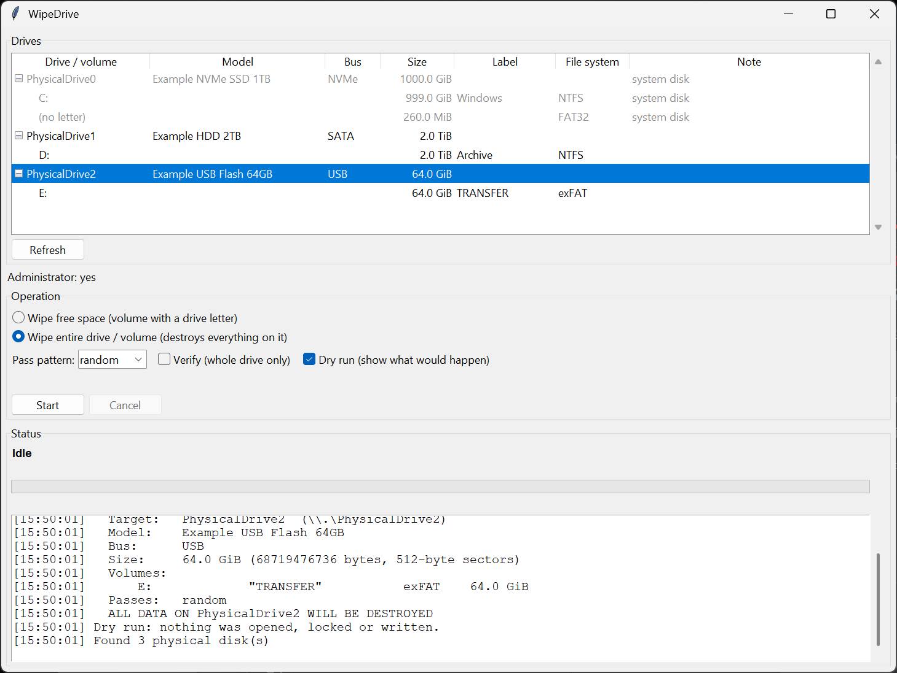

# WipeDrive

WipeDrive is a small command-line tool that overwrites data in one of two ways. The `device` command overwrites an entire physical drive or volume. The `freespace` command overwrites only the unused space on a volume, leaving existing files alone. A third command, `list`, shows the disks and volumes WipeDrive can see so you can pick the right target before doing anything destructive.



*The graphical front end after a dry run. The drives shown are made-up examples; the system disk is greyed out and cannot be selected.*

## Requirements

- **Python 3**, using the standard library only. There are no packages to install.
- **Windows** is the primary platform. Both `freespace` and `device` are supported.
- **Linux** is supported for `list`, `freespace` and `device`.
- **macOS** is supported for `freespace` only. `device` exits with code 3 and the message "unsupported platform".
- **`device` needs administrator rights** (Windows) or **root** (Linux). Without them it exits with code 3.

> **WARNING: `device` destroys data irreversibly.**
>
> It overwrites the target drive or volume from start to finish. There is no undo, no recycle bin and no recovery. Wiping the wrong disk, such as your system disk or a backup drive, cannot be reversed. Run `list` to confirm the target, then run the same command with `--dry-run`, and only then run it for real.

## Usage

```
python wipedrive.py list
python wipedrive.py freespace PATH [--passes SPEC] [--chunk-size 4M] [--dry-run]
python wipedrive.py device TARGET [--passes SPEC] [--verify] [--chunk-size 4M] [--dry-run] [--confirm TARGET]
```

### `list`

Lists the disks and volumes WipeDrive can see, with their IDs, sizes, models, buses and volumes. It takes no flags. On Windows it does not need administrator rights.

### `freespace PATH`

Overwrites the free space on the volume that contains `PATH`. `PATH` must be an existing directory; otherwise the tool refuses to run and exits with code 3.

| Flag | Default | Meaning |
| --- | --- | --- |
| `--passes SPEC` | `zero` | Pass list. See [Pass patterns](#pass-patterns). |
| `--chunk-size SIZE` | `4M` | Write block size. Accepts `K`, `M` and `G` suffixes (binary units). Must be a multiple of 4096. |
| `--dry-run` | off | Print the summary and stop without writing. |

There is no typed confirmation for `freespace`, because it cannot destroy live files. It prints a summary and then runs.

Example:

```
python wipedrive.py freespace D:\ --passes random
```

### `device TARGET`

Overwrites an entire physical drive or volume.

| Flag | Default | Meaning |
| --- | --- | --- |
| `--passes SPEC` | `zero` | Pass list. See [Pass patterns](#pass-patterns). |
| `--verify` | off | After the last pass, re-read it and compare it with the expected pattern. |
| `--chunk-size SIZE` | `4M` | Write block size. Accepts `K`, `M` and `G` suffixes. Must be a multiple of 4096. |
| `--dry-run` | off | Print the summary and stop. Nothing is opened for writing and no volume is locked. |
| `--confirm TARGET` | none | Skips the typed confirmation. The value must exactly match the target ID shown in the summary. |

Target forms:

- Windows: `PhysicalDrive2`, `\\.\PhysicalDrive2` or a volume letter such as `E:`
- Linux: `/dev/sdb`

Bare numbers such as `2` are rejected because they are ambiguous.

Examples:

```
python wipedrive.py device PhysicalDrive2 --passes dod --verify
python wipedrive.py device E: --dry-run
```

### Pass patterns

`--passes` takes a comma-separated list of pattern names, or the preset `dod`.

| Name | Bytes written |
| --- | --- |
| `zero` | `0x00` |
| `one` | `0xFF` |
| `random` | Pseudo-random data from a seeded generator (not cryptographic). Each pass uses a new seed. |
| `dod` | Preset that expands to `zero,one,random`. The name is a label for this preset; the tool makes no claim that it satisfies any particular standard. |

The default `zero` is a single pass. The design rationale is that one pass is considered sufficient for NIST SP 800-88 "Clear" on modern drives. That is a design rationale, not a certification. See [Limitations](#limitations) for what overwriting cannot guarantee.

`random` is not cryptographic. It is fast and reproducible, which lets `--verify` regenerate the expected data. It is adequate for overwriting, not for generating secrets.

## Graphical front end

```
python wipedrive_gui.py
```

`wipedrive_gui.py` is a tkinter window over the same code the command line uses. It takes no arguments.

- **Drive list.** Every detected disk is shown with its volumes. Use Refresh after plugging or unplugging a drive.
- **Disabled rows.** The system disk and all of its volumes are greyed out and cannot be selected, in both modes. This is stricter than the command line, which allows `freespace` on the system volume and `device` on a separate data volume of the system disk. Any other target the tool would refuse (dynamic or spanned volumes, no media) is disabled too, with the reason shown. If the system disk cannot be identified, every row is disabled.
- **Mode.** "Wipe free space" needs a volume with a drive letter. "Wipe entire drive/volume" takes a physical disk or a volume.
- **Options.** Pass pattern, Verify (whole-drive mode only) and Dry run.
- **Administrator rights.** Whole-drive mode, including its dry run, is disabled unless the window is elevated; the "Restart as administrator" button relaunches it with a UAC prompt. The original copy hides and stays running until the elevated window is closed, because the elevated copy can be killed if its parent exits first (this happens under the VS Code debugger). Free-space mode works without elevation.
- **Confirmation.** A whole-drive wipe opens a dialog listing what will be destroyed, and the Wipe button stays disabled until you type the target ID exactly. A free-space wipe asks for a plain OK.
- **Status.** The current pass, a progress bar, rate, ETA and a log of each step, including warnings and errors.
- **Cancel.** Stops the run and cleans up: free-space fill files are deleted, and device handles are closed. A cancelled whole-drive wipe leaves the drive partly overwritten. Closing the window during a run asks first and waits for cleanup.
- **Re-check at Start.** The disks are listed again and the selected target must still be the same device and still pass the safety rules, so a drive swapped while the window was open is refused.

## Safety model

WipeDrive is built around one principle: it should be hard to destroy the wrong thing by accident.

1. **System-disk refusal.** `device` refuses any physical drive that holds the Windows system directory, the Python interpreter running WipeDrive, or the current working directory. A volume target such as `E:` is refused only if that volume itself holds one of those; a separate data volume on the same physical disk as Windows can be wiped. A disk with no media or an inconsistent size is also refused. On Windows it also refuses any volume that spans more than one disk (spanned, dynamic or Storage Spaces volumes). On Linux it refuses any disk with a partition listed in `/proc/mounts`. A refusal exits with code 3.

2. **Summary before anything is written.** `device` prints the device ID, model, bus type, size and every volume on the target (letter, label, filesystem and size), followed by the line "ALL DATA WILL BE DESTROYED".

3. **Typed confirmation.** After the summary, you must type the target ID exactly. This requires standard input to be a terminal. If it is not a terminal and `--confirm` is absent, the tool exits with code 4. A declined or mistyped confirmation also exits with code 4.

4. **`--confirm TARGET` is the only non-interactive override.** Its value must equal the resolved target ID, so a mismatched value is refused. It exists so that scripts can run `device` on purpose, and it is deliberately narrow. There is no `--yes` flag. A generic "yes" would let a script wipe whichever disk happened to be attached.

5. **`--dry-run` shows what would happen and stops.** It exits with code 0 after printing the summary, without opening the device for writing and without locking anything. The refusal and administrator checks run before the dry-run stop, so an unsafe target or a session without administrator rights still exits with code 3 in dry-run mode.

## How the free-space wipe works

`freespace` fills the unused space on a volume with files and then removes them.

- It creates a temporary directory named `~wipefree.<8 hex characters>` inside `PATH`, and writes files named `fill_00000.bin`, `fill_00001.bin` and so on into it. A subdirectory avoids limits on the number of entries in a FAT root directory.
- Each file is capped at 1 GiB. This stays under the FAT32 4 GiB file limit without WipeDrive needing to detect the filesystem, and it limits what is lost if the run is interrupted.
- Files are written unbuffered in `--chunk-size` blocks, and each file is flushed to disk before it is closed.
- Extra passes rewrite the same files in place rather than creating new ones.
- When the disk reports full, the block size is halved down to 4096 bytes to fill the remaining space, then the run stops. A disk-full error while creating a new file also counts as "done".
- **The volume is briefly full.** WipeDrive keeps no reserve. Other programs writing to the same volume may fail for a short time while the run is in progress. This is most noticeable on `C:`.
- **Compression guard (Windows).** The tool refuses to run if the temporary directory has the compressed attribute, because zeros would compress and the volume would never fill.
- **Growth guard.** The tool aborts if it has written more than the starting free space plus 1% plus 64 MiB. This catches compression, deduplication and thin provisioning on any OS, which would otherwise make the volume appear to hold more data than it does.
- **Cleanup.** Files and the temporary directory are removed in a `finally` block, so cleanup runs on success, on error and on Ctrl+C. If cleanup itself fails, the path is printed so you can remove it by hand.
- **Stale directories.** If earlier runs left `~wipefree.*` directories behind, WipeDrive prints a warning and leaves them alone. It does not delete directories it did not create in the current run.
- Free-space wiping does not verify its output. Reading back free space returns data from the operating system's cache, so a read-back would prove nothing.

## Exit codes

| Code | Meaning |
| --- | --- |
| 0 | Success. Also used for a successful `--dry-run`. |
| 1 | I/O or other error. This includes a target that does not exist and a volume that is in use and cannot be locked. |
| 2 | Usage error: invalid arguments or a malformed target such as a bare number. |
| 3 | Refused by a safety check: system disk, not running as administrator or root, unsupported platform, or a `freespace` path that is not a directory or is NTFS-compressed. |
| 4 | Confirmation declined or missing. `--confirm` is matched case-sensitively against the ID shown in the summary. |
| 5 | Verification mismatch (`--verify`). |
| 130 | Interrupted with Ctrl+C. |

When `device` cannot lock a volume it exits with code 1 and prints "volume in use, close Explorer/AV handles". WipeDrive never forces a dismount without first obtaining a lock.

## Limitations

Read this section before relying on WipeDrive for anything that matters.

- **SSDs and NVMe drives.** Wear levelling, over-provisioning and TRIM mean that overwriting through the normal interface may not reach every physical cell that held your data. For solid-state drives, use the drive's own secure-erase mechanism: ATA Secure Erase, NVMe Format or Sanitize, or the vendor's tool.
- **Remapped and reallocated sectors, and HPA/DCO areas,** are not reachable through the normal interface, so WipeDrive cannot overwrite them.
- **Shadow copies.** `freespace` does not touch Volume Shadow Copy storage, and overwriting freed blocks can copy old data into that storage. Run `vssadmin delete shadows` first. The NTFS journals (`$LogFile` and the USN journal), hibernation files and the pagefile can also keep copies of data.
- **What `freespace` does not cover:**
  - File slack (the unused tail of a file's last cluster).
  - Small files whose data is stored inside the MFT record. WipeDrive does not write small files to reach these, because that would grow the MFT permanently and is slow.
  - Data on copy-on-write or compressed filesystems (ReFS, btrfs, ZFS, APFS) and on deduplicated volumes.
  - Free space beyond per-user disk quotas.
- **No forensic guarantee.** WipeDrive does not provide one. If you need data to be unrecoverable, encryption (BitLocker on Windows) is the stronger approach.
- **Raw device paths are not verified on hardware.** Some Windows behaviour used by `device` could only be confirmed on a real device, and the design notes list these as unverified:
  - Whether `FSCTL_ALLOW_EXTENDED_DASD_IO` is needed and works, which controls access to the last sectors of a disk.
  - Whether locking and dismounting every volume on a disk (including volumes without letters, such as EFI and Recovery partitions) is enough for full-disk writes, or whether the disk also has to be taken offline.
- **Linux verification is best effort.** The kernel may still serve reads from cache on some systems, so `--verify` on Linux may not reread the data from the device.

Test any `device` wipe on a disposable drive first.

## Running the tests

The tests need no administrator rights and no real devices.

```
python -m unittest test_wipedrive test_wipedrive_gui -v
```

The GUI tests open and close a window briefly, so they need a display.

On Windows the suite includes a smoke test that runs only on Windows and checks that `list` flags a disk as the system disk.
